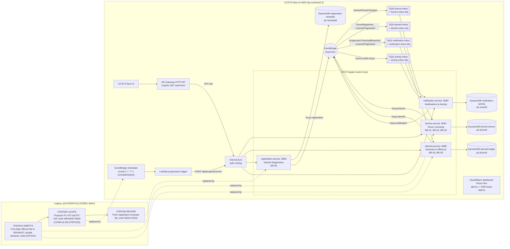

# LICSYS Next: production architecture

*Fictional demo system. Generated by `npm run diagram` from `lib/config.ts`; do not edit by hand.*

## Legacy JCL steps -> AWS components

| JCL step | Program | Legacy behaviour | LICSYS Next |
|---|---|---|---|
| STEP010 | DMRPTS | Post daily offence file to DRVMAST, double demerits, write NOTICES | demerit-service POST /api/offences (real time) -> EventBridge DemeritPointsChanged / SuspensionThresholdReached -> notification-service |
| STEP020 | LICUPG | Progress P1->P2 and P2->OP, write DRVMAST.NEW (COND=(0,NE,STEP010)) | EventBridge Scheduler (nightly) -> progression-trigger Lambda -> licence-service POST /api/progression/run |
| STEP030 | REGFEE | Price registration renewals file, write REGO.FEES | registration-service POST /api/renewals/quote and /api/renewals (on demand, no batch) |

The legacy step order (DMRPTS before LICUPG, `COND=(0,NE,STEP010)`) becomes an ordering guarantee in the new system:
offences post in real time and `DemeritPointsChanged` updates licence-service's points projection long before the
nightly progression sweep runs at cron(0 2 * * ? *) Australia/Sydney (LICNIGHT ran after the
~01:30 offence feed landed). Failed runs retry 3 times, then land in `licsys-progression-schedule-dlq` and alarm.

## Event routing (`licsys-bus`)

| Rule | Queue (DLQ) | Receives | Consumer |
|---|---|---|---|
| to-licence-inbox | licence-inbox (licence-inbox-dlq) | DemeritPointsChanged | licence-service |
| to-demerit-inbox | demerit-inbox (demerit-inbox-dlq) | DriverRegistered, LicenceProgressed | demerit-service |
| to-notification-inbox | notification-inbox (notification-inbox-dlq) | SuspensionThresholdReached, LicenceProgressed | notification-service |
| to-activity-inbox | activity-inbox (activity-inbox-dlq) | all events, source prefix `licsys.` | notification-service |
